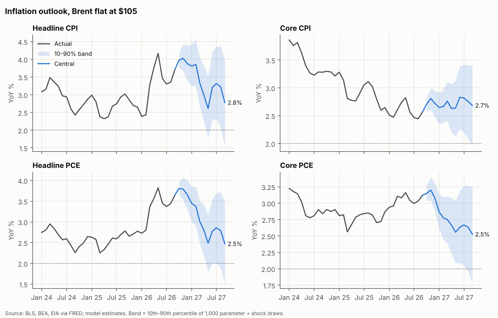

# oil-inflation-model

A reproducible model of how oil shocks reach US inflation (CPI and PCE, headline and core,
MoM and YoY) and how the inflation path reaches inflation expectations, real yields and
technology stocks. Built for the Top Down Fund to test one thesis: if the 2026 oil shock is a
one-time level shift, inflation cools and growth stocks benefit.

**Read the paper: [docs/paper.md](docs/paper.md)**. It covers the rationale, data, models,
robustness tests, scenarios and portfolio implications.



## Headline results (data through Sep 2026)

| | Sep-26 actual | Sep-27, Brent flat $105 (10–90% band) | Sep-27 range across 9 oil scenarios |
|---|---|---|---|
| Headline CPI YoY | 3.72% | 2.8% (1.6–4.0) | 1.6% – 3.7% |
| Core CPI YoY | 2.57% | 2.7% (2.0–3.4) | 2.6% – 2.8% |
| Headline PCE YoY | 3.65% | 2.5% (1.5–3.5) | 1.6% – 3.2% |
| Core PCE YoY | 3.12% | 2.5% (1.8–3.2) | 2.4% – 2.6% |

- **Oil moves headline, not core.** A +10% Brent move lifts the headline CPI level 0.39% (half
  within a month) and core PCE only 0.07% (not distinguishable from noise in a placebo test).
- **Inflation falls under every oil path**, mostly from base effects. Core PCE settles near
  0.20–0.22% a month.
- **Biggest risk to core: the post-2021 regime.** Re-estimated on 2010–2025, Sep-27 core PCE is
  2.9%, not 2.5%.
- **Oil to tech through rates is weak.** If the Fed reacts to core PCE, XLK gets +1.2% to +2.4%
  from lower real yields in every scenario. Oil matters only if the Fed reacts to headline
  inflation (+0.7% to +4.6%).

## Quick start

```bash
git clone <this repo> && cd oil-inflation-model
pip install -e ".[dev]"          # numpy, pandas, statsmodels, scipy, matplotlib, pyyaml, pytest
python -m oilinfl                # full run, about 1 minute -> outputs/
python -m pytest -q              # 26 tests
```

- **Quick check:** `python -m oilinfl --fast --skip-robustness` runs in about 5 seconds.
- **Make shortcuts:** `make run`, `make test`, `make data`.

## How it works

```
Brent / refined fuels ──► ARDL(6,12) inflation models ──► MoM path ──► YoY, 3m/6m annualized
   (scenario paths)         per series, anchored to the        │         fan charts (bootstrap)
                            10y breakeven                      ▼
                                              core / headline PCE YoY path
                                                       │
     oil ──► breakevens (5y, 10y) ─────────────────────┤
                                                       ▼
                   Fed rule (2y yield) ──► 10y real yield (TIPS) ──► XLK (real-yield beta)
```

| Module | What it does |
|---|---|
| `src/oilinfl/data.py` | Loads data and puts every series on one monthly calendar; log-percent inflation, exact YoY, gap filling |
| `src/oilinfl/model.py` | ARDL estimation (HAC errors), long-run effects, impulse responses, vectorized simulator, block bootstrap |
| `src/oilinfl/anchor.py` | Replaces the intercept so forecasts converge to market inflation expectations |
| `src/oilinfl/forecast.py` | Brent scenario paths, point forecasts, residual settings, bootstrap fan charts |
| `src/oilinfl/rates.py` | Breakevens, Fed reaction function (estimated and hawkish), real-yield pass-through, XLK beta |
| `src/oilinfl/robustness.py` | Lag grid, out-of-sample tests with Diebold–Mariano, subsamples, Chow, asymmetry, placebo, 2026 backtest |
| `src/oilinfl/diagnostics.py` | Refined-fuel drivers, transportation attribution, pass-through timing |
| `src/oilinfl/pipeline.py` | Runs everything and writes `outputs/` |
| `config.yaml` | Every setting: samples, lags, anchor, scenarios, rates samples, robustness options |

## Robustness at a glance

- **Out of sample (213 rolling forecasts, 2005–2024), 12-month horizon, given the oil path:**
  - headline CPI/PCE error is 32–33% below a no-oil model and 42–44% below a random walk;
  - energy error is 61–65% below a no-oil model;
  - core error is 13–24% below a random walk, with no gain from oil.
- **Design choices tested, not assumed:**
  - 6 own lags instead of 3 cuts core forecast error 25–30%;
  - the breakeven anchor helps headline (p = 0.04–0.07);
  - carrying recent errors forward hurts (p < 0.05), so errors fade in the central case.
- **Stability:** headline pass-through is 0.30–0.34 across 1988–2007, 2008–2019 and
  2010–2025, and 0.32–0.54 across 25 lag specifications. There is no asymmetry between oil rises
  and falls. Core's oil sensitivity rose after 2021, and that is reported as a regime risk.
- **Placebo:** randomly time-shifted oil series never produce the headline or energy effects
  (p = 0.000). They often produce effects as big as core's (p ≈ 0.2).

## Scenarios

Scenarios are Brent paths in `config.yaml`:
- flat at $114 or $105;
- +20% or −25% in November or April;
- up-down-up;
- $125 from November;
- a glide to $75 by January.

To add one, write a new entry, for example:

```yaml
my_scenario: {label: "Spike to $140 in Dec, back to $100 in Mar",
              steps: [{from: "2026-12", level: 140}, {from: "2027-03", level: 100}]}
```

Each scenario produces MoM, YoY, and 3- and 6-month annualized paths for every series, with
10–90% bands. It also produces breakeven, 2-year, 10-year real and XLK paths under both Fed
rules.

## Updating the data

`python scripts/update_data.py` refreshes all FRED series and the 3-2-1 crack spread, with no
API key. Two inputs are manual (see `data/README.md`):

- BEA Table 2.8.7, unless you pass `--bea YOUR_KEY`;
- the XLK price export.

Then set `forecast.origin` in `config.yaml` to the new last month and re-run. The pipeline
stops with an error if any series ends before the origin.

## Outputs

`outputs/tables/` holds 28 CSVs, `outputs/figures/` the charts, and `outputs/results.json`
everything in one file. `scripts/paper_tables.py` regenerates the paper's tables from them.

## Caveats

This is a research tool for a student investment group, not investment advice. The models are
reduced-form. The links from inflation to the Fed and to XLK explain only part of what moves
yields and tech stocks. See section 9 of the paper.
