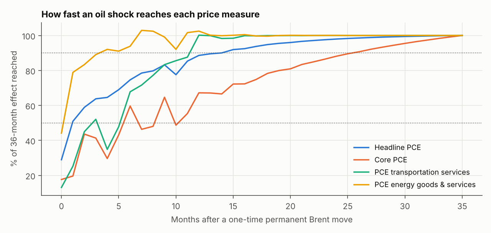
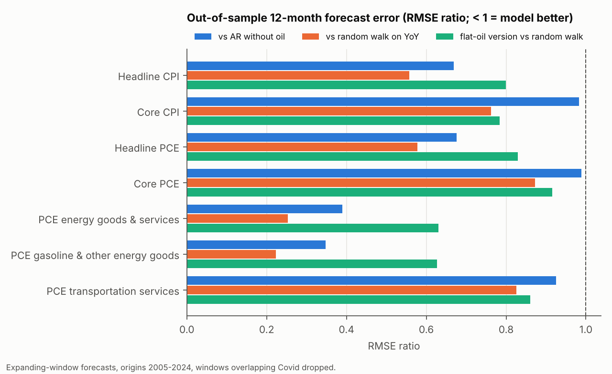
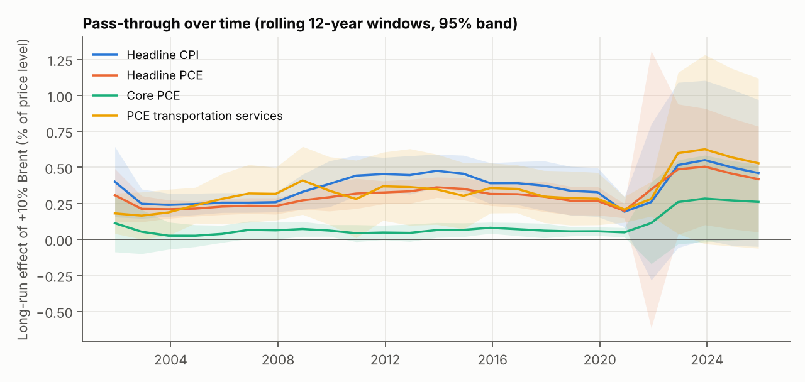
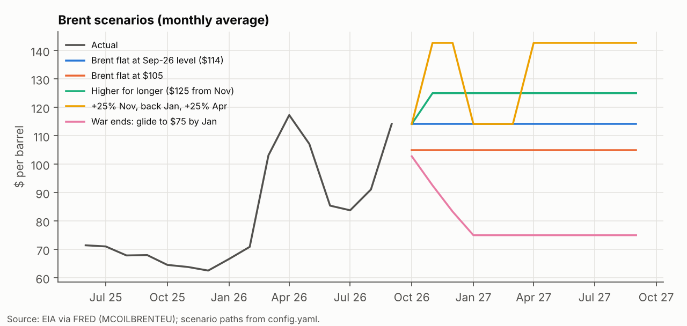
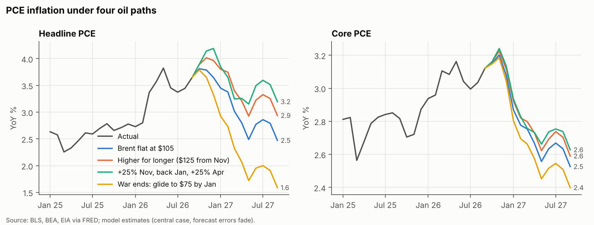
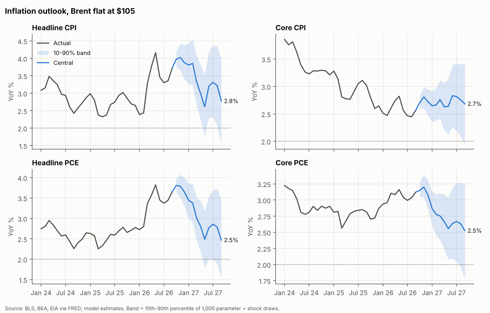
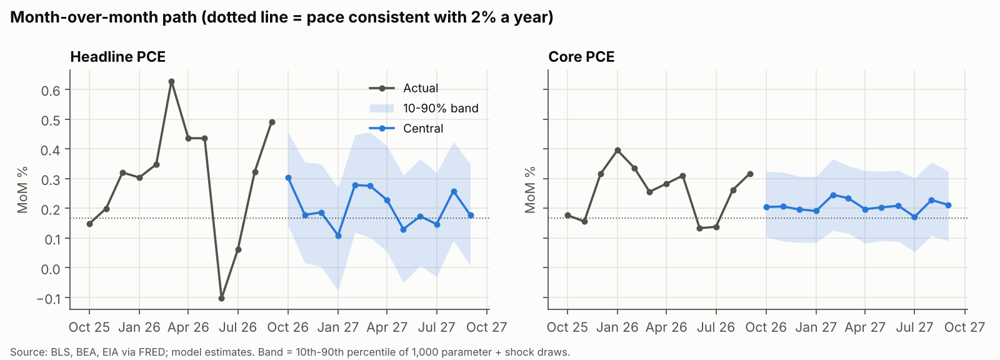
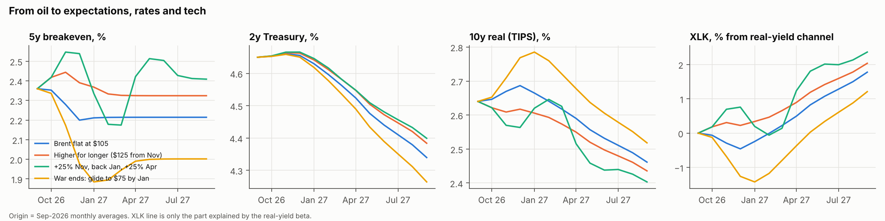
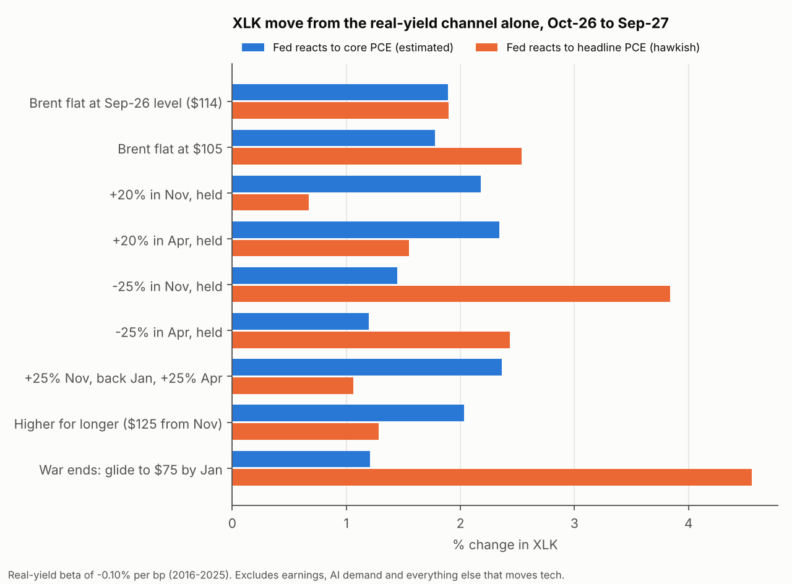

# Oil, Inflation and Real Yields: A Scenario Model for the 2026 Energy Shock

**Top Down Fund research note — November 2026**
Data through September 2026 (rates through October 2026). Every number below comes from
`outputs/` and is reproducible with `python -m oilinfl`; the tables were generated by
`scripts/paper_tables.py`.

---

## Summary

The question behind this work is the fund's thesis. Oil and inflation hurt AI and
information-technology stocks mainly through interest rates. So if the oil shock is a
one-time *level* shift that monthly inflation adjusts to, growth stocks should be the best
place to be as inflation cools. We built a model that runs from oil to US inflation (CPI and
PCE, headline and core) and from inflation to breakevens, real yields and technology stocks.
We then tested it out of sample and ran nine oil scenarios through it.

1. **Oil moves headline inflation a lot and core inflation very little.** A permanent 10% rise
   in Brent raises the headline CPI level by 0.39% and headline PCE by 0.31%. Half of that
   arrives in the first month after the move. Core PCE rises by only 0.07%, and a placebo test
   cannot tell that effect apart from noise (p = 0.19).
2. **Inflation is at or near its peak under every oil path we tested.** With Brent flat at
   $105, headline PCE falls from 3.65% (Sep-26) to 2.5% by Sep-27, and core PCE from 3.12% to
   2.5%. Most of the decline is base effects: the 2026 jumps drop out of the 12-month window.
   Even "Brent at $125 for a year" leaves headline PCE at 2.9% and core at 2.6%. Monthly core
   PCE settles near 0.20–0.22% a month, a 2.4–2.7% annual pace.
3. **The oil path changes headline inflation by about 1.6 points and core by about 0.2.**
   Across the nine scenarios, Sep-27 headline PCE ranges from 1.6% to 3.2% and core PCE from
   2.4% to 2.6%.
4. **The biggest risk to the core outlook is not oil.** It is whether the post-2021 regime
   persists. Re-estimating on 2010–2025 data roughly triples core's oil sensitivity and lifts
   the Sep-27 core PCE forecast from 2.5% to 2.9%. In 2026, core PCE has run about 0.5 points
   above what oil explains, mostly in transportation services and recreational goods.
5. **The road from oil to tech through rates is short and weak.** Higher oil raises
   breakevens (+0.06pp per +10% Brent). Because nominal yields rise less than breakevens, the
   10-year *real* yield falls slightly. If the Fed reacts to core PCE, as it has since 2016,
   every scenario lowers the 2-year by 0.24–0.39pp. XLK gains only +1.2% to +2.4% from the
   real-yield channel, and the oil path barely matters.
6. **Oil matters for tech only if the Fed reacts to headline inflation.** Under that hawkish
   rule, the real-yield channel is worth +4.6% to XLK if the war ends (Brent to $75) and +0.7%
   if oil rises 20%.
7. **What this means for the thesis.** "Inflation cools even if oil stays high" is supported.
   "Cooling inflation drives a growth rally through lower real yields" is supported in
   direction but small in size: the real-yield beta explains about 16% of XLK's monthly moves
   since 2016, and none before. The growth case rests on earnings, not on disinflation.

---

## 1. Motivation

Brent averaged about $69 a barrel in 2025. It jumped to $103 in March 2026 when the war
began and averaged $114 in September 2026. Headline CPI inflation rose from 2.4% in early 2026
to 3.7%. The fund's thesis has two parts:

- **(a)** oil and inflation are not directly tied to AI and information technology, but rate
  hikes are;
- **(b)** if month-over-month inflation cools because prices settle at the new oil level, so
  that the level shifts once instead of rising continuously, growth stocks are the best bet.

Testing (b) needs three things: how much and how fast oil reaches each inflation measure; where
inflation goes under different oil paths; and whether those paths move the real yields that
matter for long-duration equities. This note builds all three in one reproducible pipeline.

## 2. Data

All inputs are public monthly series, mainly from FRED, plus BEA's Table 2.8.7 for PCE product
detail and a daily XLK price file. `data/README.md` lists every file.

| Block | Series | Sample used |
|---|---|---|
| Inflation targets | CPI (CPIAUCSL), core CPI (CPILFESL), PCE (PCEPI), core PCE (PCEPILFE); PCE energy, gasoline and transportation services (BEA 2.8.7) | 1988-06 to 2025-12 for estimation; history to 2026-09 |
| Oil | Brent monthly average (MCOILBRENTEU) | from 1987-05 |
| Refined products | Retail gasoline, retail diesel, Gulf jet fuel, PPI refined petroleum, 3-2-1 crack spread | from 1990–1995 |
| Expectations and rates | 5y and 10y breakevens, 5y and 10y TIPS yields, 2y Treasury, fed funds, unemployment | 2003+ (TIPS), 1990+ (2y) |
| Equity | XLK and ten other SPDR sector ETFs, daily close | 1998+ (XLRE 2015, XLC 2018) |

**How the data were formatted, and why.**

- **One monthly calendar.** Every series is put on a complete monthly index before any lag is
  taken. A missing month (October 2025 CPI was never published because of the government
  shutdown) would otherwise silently misalign every 12-month comparison. A unit test checks
  this.
- **Inflation in log-percent.** Monthly inflation is 100 × Δln(index). Log changes add up, so
  year-over-year inflation is computed exactly from the monthly path. Every YoY figure matches
  the published index ratios.
- **Monthly averages.** Weekly fuel prices, daily XLK and daily crack spreads are averaged
  within the month, matching how Brent, CPI and PCE are measured.
- **Short gaps interpolated.** Gaps of up to three months are filled log-linearly (only October
  2025 for CPI and unemployment). Longer gaps are never filled.
- **Covid months excluded from estimation.** March 2020 to June 2021 is dropped from
  estimation, because lockdown pricing had nothing to do with oil. Including them barely
  changes the headline pass-through (0.41 versus 0.39).
- **Validation.** Headline and core PCE match BEA's published monthly changes in every month,
  1990–2026. The 10-year real yield plus the 10-year breakeven reproduces the nominal 10-year to
  within 0.01pp.

## 3. The inflation model

For each inflation series *y* (monthly log-percent) we estimate an autoregressive
distributed-lag model on Brent's monthly log change *x*:

$$y_t = c + \sum_{j=1}^{6} a_j\, y_{t-j} + \sum_{k=0}^{12} b_k\, x_{t-k} + e_t$$

- **Why this form.** It separates the two things the thesis is about: how much oil eventually
  matters (the long-run effect, $\sum b / (1-\sum a)$) and how fast it arrives (the path of
  cumulative effects). It is linear and transparent, and it simulates cleanly under any oil
  path.
- **Why 6 own lags and 12 oil lags.** We chose them out of sample, not by fit. With 3 own lags
  (the specification used earlier), core CPI and core PCE forecasts were worse than a random
  walk. With 6, their 12-month forecast error falls by 25–30% and beats the random walk
  (Section 5). Twelve oil lags let slow-moving core measures absorb a shock over a year.
  Pass-through barely changes across 25 lag combinations.
- **Why Brent.** It is the global benchmark, available since 1987, and what scenarios are
  written in. Refined products are tested separately in Section 4.3.
- **Standard errors.** Newey-West (HAC, 12 lags), because the residuals are autocorrelated and
  heteroskedastic (Section 5.5).

**Expectations anchor.** Left alone, the intercept pulls every forecast toward the 1988–2025
average, about 2.8% for CPI. That is above where inflation settled once expectations were
anchored. At forecast time we therefore replace the intercept so that, with oil flat, CPI
inflation converges to the 10-year breakeven (2.35%). PCE converges to the breakeven minus the
trailing 10-year CPI–PCE gap: 1.96% for headline and 2.07% for core. The slopes are unchanged.
Out of sample, the anchor lowers 12-month forecast error by 8% for headline CPI (p = 0.07) and
5% for headline PCE (p = 0.04), and makes no significant difference for core.

**Forecast errors fade.** We tested carrying recent forecast errors forward, either decaying or
persisting. Both make forecasts significantly worse. For core PCE, error rises from 0.58 to
0.81 points (p < 0.001), because the six own lags already carry momentum. The central case
therefore lets errors fade. The other settings are kept only as sensitivities in
`scenarios_long.csv`.

**Uncertainty bands.** We take 1,000 draws of coefficients (from their estimated distribution)
and of shocks (resampled in 6-month blocks from the model's own errors). Every scenario uses
the same draws, so differences between scenarios are not noise. We report the 10th–90th
percentile range.

## 4. What the model finds

### 4.1 Pass-through and timing

| Series | R² | Long-run effect of +10% Brent, % (s.e.) | After 12 months | 50% reached by month | 90% by month | Oil lags jointly significant (p) | Placebo p |
|---|---|---|---|---|---|---|---|
| Headline CPI | 0.52 | 0.39 (0.09) | 0.35 | 1 | 12 | 0.000 | 0.000 |
| Core CPI | 0.50 | 0.10 (0.08) | 0.02 | 13 | 29 | 0.109 | 0.238 |
| Headline PCE | 0.51 | 0.31 (0.08) | 0.26 | 1 | 14 | 0.000 | 0.000 |
| Core PCE | 0.42 | 0.07 (0.07) | 0.04 | 6 | 26 | 0.000 | 0.188 |
| PCE energy | 0.57 | 3.36 (0.31) | 3.42 | 1 | 4 | 0.000 | 0.000 |
| PCE gasoline | 0.61 | 4.95 (0.38) | 5.05 | 0 | 2 | 0.000 | 0.000 |
| PCE transportation services | 0.08 | 0.35 (0.12) | 0.31 | 3 | 12 | 0.001 | 0.000 |

*Month 0 is the month of the oil move. "Placebo p" is the share of 500 regressions on randomly
time-shifted oil series whose effect is at least as large as the real one.*



- **Energy prices reprice almost immediately.** 90% of the effect arrives within four months.
- **Headline CPI and PCE get halfway within a month**, and most of the rest within a year.
- **Core is slow and small.** Core PCE reaches half of a tiny long-run effect after 6 months
  and 90% after about two years. For core CPI and core PCE, the oil effect is not
  distinguishable from what randomly timed oil movements produce (placebo p of 0.19–0.24).

This is the level-shift mechanism behind the thesis. An oil move shifts the *price level* once
and lifts *monthly* inflation only temporarily. Prices do not give the increase back when oil
stabilizes; inflation does.

### 4.2 What explains 2026 so far

We simulated January–September 2026 starting from December 2025 data, once with actual Brent
and once with Brent held flat:

| Series | Actual YoY Sep-26 | Model | Model with oil flat | Oil contribution, Jan–Sep (pp) | Unexplained (pp) |
|---|---|---|---|---|---|
| Headline CPI | 3.72 | 4.05 | 2.41 | 1.59 | −0.32 |
| Core CPI | 2.57 | 2.35 | 2.22 | 0.13 | 0.21 |
| Headline PCE | 3.65 | 3.60 | 2.41 | 1.15 | 0.05 |
| Core PCE | 3.12 | 2.63 | 2.45 | 0.18 | 0.47 |
| PCE energy | 21.47 | 18.36 | 0.55 | 16.30 | 2.59 |
| PCE transportation services | 9.36 | 3.51 | 2.37 | 1.11 | 5.50 |

- **Headline PCE is almost fully explained.** The model gets 3.60% against an actual 3.65%,
  and oil accounts for about 1.2 points of the rise.
- **Core PCE runs about 0.5 points above the model.** The excess is concentrated in
  transportation services, where 5.5pp of the rise is unexplained, and in recreational goods.
  Earlier component work traced recreational goods mainly to consumer electronics, most likely
  AI-driven memory demand and tariffs.

### 4.3 Refined products and transportation

Swapping Brent for refined-product prices (estimated 1995–2025):

| Series | Driver | R² | Long-run +10% | Share of the 2026 rise explained |
|---|---|---|---|---|
| Headline PCE | Brent | 0.53 | 0.34 | 42% |
| Headline PCE | Retail diesel | 0.56 | 0.40 | 62% |
| Core PCE | Brent | 0.35 | 0.09 | 9% |
| Core PCE | Jet fuel | 0.35 | 0.08 | 12% |
| PCE transportation services | Brent | 0.11 | 0.38 | 14% |
| PCE transportation services | Retail diesel | 0.15 | 0.75 | 29% |
| PCE transportation services | Jet fuel | 0.16 | 0.41 | 25% |

*(The full table, with gasoline and PPI refined petroleum, is `outputs/tables/fuel_variants.csv`.
For PCE energy, refined fuels "explain" more than 100% of 2026 because retail prices rose more
than Brent; other energy items fell.)*

Refined prices explain more of the transportation spike than crude does, because the refining
margin widened sharply. The 3-2-1 crack spread averaged $66 a barrel in September against a
2015–2025 average of $21. Still, the best model leaves most of the rise unexplained:

| Transportation services, Jan–Sep 2026 (pp) | Adj. R² | Actual | Fuels | General inflation | Own lags + constant | Unexplained |
|---|---|---|---|---|---|---|
| Fuels only | 0.11 | 8.25 | 3.69 | — | 0.56 | 4.00 |
| Fuels + core inflation | 0.15 | 8.25 | 3.11 | 3.97 | −2.37 | 3.54 |

Fuels (Brent, diesel, jet) and general inflation together explain a little over half. About
3.5 points remain. The candidates we could not test with the data in hand are airline
capacity and pricing, and auto insurance.

## 5. Robustness

### 5.1 Out-of-sample forecasting

For every month from January 2005 to December 2024 we re-estimate on data available at the
time and forecast the next 12 months of inflation. Windows that overlap the Covid exclusion are
dropped, leaving 213 forecasts per series. "AR" is the same model without oil; "RW" uses the
last 12 months of inflation as the forecast for the next 12. The ratio is model RMSE divided by
benchmark RMSE, so below 1 means the model is better. p-values are Diebold–Mariano tests with
the Harvey–Leybourne–Newbold correction.

| Series | Model RMSE (pp) | vs AR | vs RW | Flat-oil version vs RW |
|---|---|---|---|---|
| Headline CPI | 1.13 | 0.67 (p 0.02) | 0.56 (p 0.04) | 0.80 (p 0.14) |
| Core CPI | 0.56 | 0.98 (p 0.40) | 0.76 (p 0.23) | 0.78 (p 0.27) |
| Headline PCE | 0.90 | 0.68 (p 0.03) | 0.58 (p 0.06) | 0.83 (p 0.20) |
| Core PCE | 0.58 | 0.99 (p 0.66) | 0.87 (p 0.49) | 0.92 (p 0.66) |
| PCE energy | 5.09 | 0.39 (p 0.01) | 0.25 (p 0.01) | 0.63 (p 0.03) |
| PCE gasoline | 6.85 | 0.35 (p 0.01) | 0.22 (p 0.02) | 0.63 (p 0.05) |
| PCE transportation services | 2.44 | 0.93 (p 0.12) | 0.83 (p 0.38) | 0.86 (p 0.51) |



- **Given the oil path, headline forecasts improve by about a third.** The model beats the
  no-oil model by roughly a third for headline CPI and PCE, and by 60–65% for energy. This is
  the relevant test for scenario analysis, where the oil path is an input.
- **Core gains nothing from oil.** The core models beat a random walk (by 13–24%) because of
  their own dynamics and the anchor, not because of oil. They are no better than the same
  model without oil.
- **The "flat oil" version still beats a random walk for headline** (by 17–20%, not
  significant). That is the realistic case where nobody knows the oil path.

### 5.2 Stability across time, lag choices and Covid

| Series | Baseline | 1988–2007 | 2008–2019 | 2010–2025 | 25 lag specs (min–max) | Covid included | Rise / fall (p equal) |
|---|---|---|---|---|---|---|---|
| Headline CPI | 0.39 | 0.30 | 0.33 | 0.34 | 0.32 to 0.54 | 0.41 | 0.34 / 0.42 (0.62) |
| Headline PCE | 0.31 | 0.24 | 0.27 | 0.33 | 0.25 to 0.41 | 0.32 | 0.30 / 0.30 (0.97) |
| Core PCE | 0.07 | 0.04 | 0.06 | 0.20 | 0.06 to 0.14 | 0.17 | 0.14 / −0.00 (0.24) |
| PCE energy | 3.36 | 2.97 | 3.56 | 3.39 | 3.16 to 4.11 | 3.23 | 3.08 / 3.55 (0.34) |
| PCE transportation | 0.35 | 0.19 | 0.28 | 0.44 | 0.21 to 0.59 | 0.46 | 0.46 / 0.26 (0.31) |

- **Headline and energy pass-through is stable** across 35 years, 25 lag specifications and
  the Covid choice. A Chow test does reject a 2008 break in the full coefficient set (p < 0.01
  for most series), but the break is in inflation's own persistence, not in oil's long-run
  effect.
- **Oil rises and falls pass through equally.** No series shows asymmetry (p = 0.24 to 0.97),
  so the scenarios treat increases and decreases the same way.
- **Core PCE's oil sensitivity is not stable.** In rolling 12-year windows it sits at about
  0.05 until windows start to include 2021–2025, then jumps to about 0.26. Either oil now
  reaches core more strongly, or the 2021–22 supply shocks, which coincided with an oil spike,
  are being attributed to oil. We cannot tell which with this data. Section 6.3 shows what it
  would mean.



### 5.3 Residual diagnostics

Durbin–Watson statistics are about 2.0, so there is no first-order autocorrelation left. The
Breusch–Godfrey test still rejects at 12 lags for the aggregates (p < 0.01). Volatility
clusters (ARCH) and errors are fat-tailed (Jarque–Bera). These failures are the reason for
HAC standard errors and the block bootstrap, which assume neither independent nor normal
errors. The RESET test flags some non-linearity in most series, most strongly energy and gasoline. The asymmetry test
found nothing, so we kept the model linear. Full table: `outputs/tables/model_summary.csv`.

## 6. Outlook and scenarios

### 6.1 Where inflation stands (September 2026)

| Series | MoM % | YoY % | 3-month annualized % |
|---|---|---|---|
| Headline CPI | 0.65 | 3.72 | 4.56 |
| Core CPI | 0.33 | 2.57 | 3.41 |
| Headline PCE | 0.49 | 3.65 | 3.56 |
| Core PCE | 0.32 | 3.12 | 2.90 |

The September jump in Brent, from $91 to $114, explains the hot headline print. Core PCE above
core CPI is unusual. It partly reflects PCE's larger weight on transportation services, whose
airfare component BEA builds from producer prices.

### 6.2 Scenario results

The nine Brent paths are defined in `config.yaml`, starting from $114, the September average.



**Headline and core PCE, YoY %** (central case; 10–90% band for Sep-27):

| Scenario | Headline Dec-26 | Headline Mar-27 | Headline Sep-27 (band) | Core Dec-26 | Core Mar-27 | Core Sep-27 (band) |
|---|---|---|---|---|---|---|
| Flat $114 | 3.8 | 3.2 | 2.7 (1.7–3.7) | 3.1 | 2.8 | 2.6 (1.8–3.3) |
| **Flat $105 (central)** | **3.6** | **3.0** | **2.5 (1.5–3.5)** | **3.1** | **2.8** | **2.5 (1.8–3.2)** |
| +20% in Nov | 4.1 | 3.6 | 3.2 (2.2–4.2) | 3.1 | 2.8 | 2.6 (1.9–3.4) |
| +20% in Apr | 3.8 | 3.2 | 3.1 (2.2–4.2) | 3.1 | 2.8 | 2.6 (1.9–3.3) |
| −25% in Nov | 3.3 | 2.6 | 2.0 (1.0–3.0) | 3.1 | 2.7 | 2.5 (1.7–3.2) |
| −25% in Apr | 3.8 | 3.2 | 2.1 (1.1–3.1) | 3.1 | 2.8 | 2.5 (1.7–3.2) |
| +25% Nov, back Jan, +25% Apr | 4.2 | 3.2 | 3.2 (2.2–4.2) | 3.1 | 2.8 | 2.6 (1.9–3.3) |
| $125 from Nov | 4.0 | 3.4 | 2.9 (2.0–3.9) | 3.1 | 2.8 | 2.6 (1.8–3.3) |
| Glide to $75 by Jan | 3.3 | 2.3 | 1.6 (0.6–2.6) | 3.0 | 2.7 | 2.4 (1.7–3.1) |

**Headline and core CPI, YoY %:**

| Scenario | Headline Dec-26 | Headline Mar-27 | Headline Sep-27 (band) | Core Dec-26 | Core Mar-27 | Core Sep-27 (band) |
|---|---|---|---|---|---|---|
| Flat $114 | 4.1 | 3.6 | 3.1 (1.9–4.3) | 2.7 | 2.8 | 2.7 (2.0–3.4) |
| **Flat $105 (central)** | **3.9** | **3.3** | **2.8 (1.6–4.0)** | **2.7** | **2.8** | **2.7 (2.0–3.4)** |
| +20% in Nov | 4.6 | 4.2 | 3.7 (2.4–5.0) | 2.7 | 2.8 | 2.8 (2.0–3.5) |
| +20% in Apr | 4.1 | 3.6 | 3.7 (2.4–4.9) | 2.7 | 2.8 | 2.7 (2.0–3.5) |
| −25% in Nov | 3.4 | 2.7 | 2.1 (0.9–3.3) | 2.7 | 2.7 | 2.6 (1.9–3.4) |
| −25% in Apr | 4.1 | 3.6 | 2.2 (1.0–3.4) | 2.7 | 2.8 | 2.7 (1.9–3.4) |
| +25% Nov, back Jan, +25% Apr | 4.7 | 3.7 | 3.7 (2.5–5.0) | 2.8 | 2.8 | 2.7 (2.0–3.5) |
| $125 from Nov | 4.3 | 3.9 | 3.4 (2.2–4.7) | 2.7 | 2.8 | 2.7 (2.0–3.5) |
| Glide to $75 by Jan | 3.4 | 2.4 | 1.6 (0.4–2.8) | 2.7 | 2.7 | 2.6 (1.9–3.3) |




**Monthly path with Brent flat at $105 (MoM %):**

| | Oct | Nov | Dec | Jan | Feb | Mar | Apr | May | Jun | Jul | Aug | Sep |
|---|---|---|---|---|---|---|---|---|---|---|---|---|
| Headline CPI | 0.38 | 0.18 | 0.15 | 0.11 | 0.31 | 0.37 | 0.29 | 0.11 | 0.15 | 0.18 | 0.30 | 0.22 |
| Core CPI | 0.23 | 0.20 | 0.15 | 0.22 | 0.23 | 0.29 | 0.25 | 0.22 | 0.17 | 0.20 | 0.23 | 0.26 |
| Headline PCE | 0.30 | 0.18 | 0.19 | 0.11 | 0.28 | 0.28 | 0.23 | 0.13 | 0.17 | 0.15 | 0.26 | 0.18 |
| Core PCE | 0.20 | 0.21 | 0.20 | 0.19 | 0.25 | 0.23 | 0.20 | 0.20 | 0.21 | 0.17 | 0.23 | 0.21 |



**Reading the scenarios.**

- **Year-over-year falls under every path.** Even "$125 for a year" ends with headline PCE
  below today. The cause is mechanical: the March–May and September 2026 jumps leave the
  12-month window. This is the level-shift argument in numbers.
- **Monthly headline inflation drops quickly.** With oil flat it falls from 0.49% in September
  to about 0.1–0.2% by winter, then settles near 0.2%. Core PCE runs at 0.20–0.22% a month
  throughout, about a 2.5% annual pace: lower than today, but not 2%.
- **Timing matters for year-over-year.** A 25% drop in April does nothing to March numbers
  but cuts Sep-27 headline PCE by 0.6 points relative to flat $114. A rise in April does the reverse.
- **An oil whipsaw resets the base.** The "up-down-up" path ends at 3.2% headline PCE, the
  same as a single +20% move in November, because the second leg in April lands inside the
  Sep-27 window.
- **The bands are wide.** About ±1 point on headline and ±0.7 on core at a 12-month horizon.
  The scenario differences for core (about 0.2 points) are well inside that range.

**Transportation services** fall from 9.4% to about 3% by Sep-27 (2.1% to 4.0% across
scenarios). If the unexplained 2026 surge kept going at its recent pace, the model would show
10%. That is not plausible, but it shows that the unexplained part, not oil, decides this
category.

### 6.3 Regime sensitivity

Re-estimating on 2010–2025 only (the regime that includes 2021–25) changes the core outlook
more than any oil path does:

| Sep-27 YoY | Headline PCE | Core PCE | Headline CPI | Core CPI |
|---|---|---|---|---|
| Flat $105 | 2.5 → 2.7 | 2.5 → 2.9 | 2.8 → 2.7 | 2.7 → 2.7 |
| +20% Nov | 3.2 → 3.3 | 2.6 → 3.0 | 3.7 → 3.5 | 2.8 → 2.8 |
| −25% Nov | 2.0 → 2.3 | 2.5 → 2.8 | 2.1 → 2.1 | 2.6 → 2.7 |
| Glide to $75 | 1.6 → 2.0 | 2.4 → 2.7 | 1.6 → 1.6 | 2.6 → 2.6 |

If the post-2021 behavior is the right one, core PCE is still near 2.9% a year from now. That
is the Fed-relevant risk to the disinflation thesis.

## 7. From inflation to expectations, real yields and tech

### 7.1 The four links

| Link | Equation | Estimate | Fit, sample |
|---|---|---|---|
| Oil → breakevens | ΔBE = c + φ ΔBE₋₁ + Σ g_k Δln Brent | +0.060pp (5y) / +0.062pp (10y) per +10% Brent | R² 0.37 / 0.32, 2004–2025 |
| Inflation → 2-year | GS2 = a + ρ GS2₋₁ + b·coreYoY + c·U | ρ 0.92, b 0.10 → long-run 1.33pp per pt of core | R² 0.98, 2016–2025 |
| Hawkish alternative | same, headline PCE instead of core | ρ 0.95, b 0.075 → long-run 1.36 | R² 0.98, 2016–2025 |
| Lower bound | 12-month changes, 1991–2025 | core: −0.01 (p 0.97); unemployment: −1.47 (p < 0.001) | R² 0.50 |
| Front end and breakevens → 10y real | ΔFII10 = a + β ΔGS2 + γ ΔBE10 | β 0.70, γ −0.50 | R² 0.54, 2003–2025 |
| Real yield → XLK | Δln XLK = a + δ ΔFII10 (bp) | −0.099% per bp (s.e. 0.026) | R² 0.16, 2016–2025 |
| | same, 2003–2025 | −0.042% per bp (p 0.14) | R² 0.03 |

**Why these choices.**

- **The Fed rule uses levels with partial adjustment, estimated since 2016.** The
  12-month-change version finds *no* response of the 2-year to realized core inflation over
  1990–2025. The market reacts to unemployment and to expected inflation before it shows up in
  the data. The post-2016 rule, which includes the 2022–23 hiking cycle, finds a strong
  response (t = 5). We use it as the central link and treat the zero-response version as the
  lower bound. We exclude the zero-lower-bound period, when rates could not respond.
- **The 10-year real yield moves 0.70 per point of 2-year yield and −0.50 per point of
  breakeven.** When inflation expectations rise and the front end doesn't move, real yields
  fall. That is why oil shocks have tended to lower real yields, not raise them.
- **The equity link only exists recently.** Before 2016 the real-yield beta for XLK is
  indistinguishable from zero.

### 7.2 Projections (Sep-27; Sep-26 actual in first row)

| Scenario | 5y BE | 10y BE | 2y (core rule) | 10y real (core rule) | XLK, real-yield channel | 2y (hawkish) | 10y real (hawkish) | XLK (hawkish) |
|---|---|---|---|---|---|---|---|---|
| Sep-26 actual | 2.36 | 2.35 | 4.65 | 2.64 | | 4.65 | 2.64 | |
| Flat $114 | 2.27 | 2.33 | 4.36 | 2.45 | +1.9% | 4.36 | 2.45 | +1.9% |
| Flat $105 | 2.21 | 2.27 | 4.34 | 2.46 | +1.8% | 4.23 | 2.39 | +2.5% |
| +20% Nov | 2.38 | 2.45 | 4.41 | 2.42 | +2.2% | 4.62 | 2.57 | +0.7% |
| +20% Apr | 2.38 | 2.45 | 4.38 | 2.41 | +2.3% | 4.50 | 2.48 | +1.5% |
| −25% Nov | 2.09 | 2.14 | 4.29 | 2.49 | +1.4% | 3.95 | 2.26 | +3.8% |
| −25% Apr | 2.08 | 2.14 | 4.33 | 2.52 | +1.2% | 4.15 | 2.40 | +2.4% |
| Up-down-up | 2.41 | 2.47 | 4.40 | 2.40 | +2.4% | 4.58 | 2.53 | +1.1% |
| $125 from Nov | 2.32 | 2.39 | 4.38 | 2.44 | +2.0% | 4.49 | 2.51 | +1.3% |
| Glide to $75 | 2.00 | 2.06 | 4.26 | 2.52 | +1.2% | 3.79 | 2.19 | +4.6% |




**What the chain says.**

1. **Expectations follow oil, modestly.** The 5-year breakeven ends between 2.00% and 2.41%
   across scenarios, against 2.36% now. The
   10-year breakeven was 2.35% in both September and October, about where it was before the
   war, so markets already treat the shock as temporary.
2. **Disinflation pulls the 2-year down in every scenario** under the estimated rule, by 0.24
   to 0.39pp. For context, the 2-year was 4.65% in September and 4.74% in October, while fed
   funds was 3.75% and 3.88%. The market is pricing hikes; a falling core path removes part of
   that.
3. **Under the core rule, oil has the opposite sign for real yields from what the thesis
   assumes.** Higher oil raises breakevens more than it raises the 2-year, so the 10-year real
   yield ends slightly *lower* with more oil. For tech, the oil path barely matters through this
   channel: +1.2% to +2.4% in every scenario.
4. **Under the hawkish rule, oil matters for tech.** A Fed that does not look through energy
   makes the war-ending path worth +4.6% to XLK and +20% oil worth only +0.7%, a 4-point spread.
   Christiane Baumeister (Richmond Fed *Econ Focus*, Q3 2026) argues central banks should not
   look through this shock. That argument is the case for taking the hawkish column seriously.
5. **The October data are a warning.** The 10-year real yield fell 28bp during October while
   XLK fell about 9%. Real yields are not what is driving tech right now.

### 7.3 Which sectors are exposed to real yields

The XLK link generalizes to all eleven SPDR sector ETFs. For each, the monthly change in the
(average) price is regressed on the monthly change in the 10-year real yield, 2016–2025, with
Covid months excluded and HAC errors, the same treatment as XLK. Two versions are shown. *Raw*
is the sector's own return and includes the market. *Relative* subtracts the equal-weighted
average of the eleven sectors, which isolates rate sensitivity net of the market. Coefficients
are % per +50bp in the 10-year real yield (standard errors in parentheses).

| Sector | Raw | Raw R² | Relative to all sectors | Relative p | Months |
|---|---|---|---|---|---|
| Real estate | -6.3 (1.1) | 0.33 | -3.1 (0.8) | 0.000 | 116 |
| Technology | -4.9 (1.3) | 0.16 | -1.8 (0.8) | 0.035 | 116 |
| Utilities | -4.4 (1.0) | 0.20 | -1.3 (0.9) | 0.180 | 116 |
| Consumer discretionary | -4.1 (1.4) | 0.10 | -0.9 (0.9) | 0.316 | 116 |
| Communication services | -3.9 (1.3) | 0.15 | -0.5 (0.9) | 0.595 | 86 |
| Materials | -3.5 (0.8) | 0.10 | -0.4 (0.4) | 0.388 | 116 |
| Consumer staples | -3.3 (0.9) | 0.20 | -0.1 (1.0) | 0.903 | 116 |
| Health care | -3.1 (0.5) | 0.15 | +0.1 (0.9) | 0.930 | 116 |
| Industrials | -3.1 (1.2) | 0.09 | +0.1 (0.6) | 0.833 | 116 |
| Financials | -1.4 (1.5) | 0.01 | +1.8 (0.9) | 0.047 | 116 |
| Energy | +2.8 (1.3) | 0.03 | +6.0 (1.0) | 0.000 | 116 |

(`scripts/paper_tables.py` regenerates this table from `outputs/tables/sector_betas.csv`.)

**What it says.**

1. **Most sectors fall when real yields rise.** Ten of eleven have negative raw betas. Real
   estate, technology and utilities are hit hardest, the long-duration or rate-financed
   sectors. Real estate's is the largest and has the best fit (R² 0.33).
2. **Net of the market, only four sectors are distinguishable from average.** Real estate and
   technology are more exposed than average, financials and energy less. Staples, health care,
   industrials, materials and communication services are statistically average once the market
   move is removed, so their raw betas mostly reflect the market falling with real yields.
3. **Energy is the natural offset.** It has a positive beta because energy stocks rise with
   oil, and oil moves breakevens and yields. This is the one place where the sector link and
   the oil thesis are mechanically connected, and it is a reminder that the regression does not
   identify rate effects separately from the oil shocks that move both.
4. **Size.** In the model's scenarios the 10-year real yield falls 18bp (core rule) to 25bp
   (hawkish rule) by Sep-27 under flat $105 oil, which implies raw gains of about +1% to +3%
   for most sectors (real estate +2.3% to +3.2%, technology +1.8% to +2.5%) and about -1% for
   energy. `outputs/tables/sector_scenarios.csv` has every scenario. These are small next to
   the monthly volatility of any sector.

**Caveats.** The betas are comovement, not causal effects: stocks and yields respond to the
same growth and inflation news. R² is below 0.35 everywhere, the link is unstable across
regimes (section 9), and the monthly-average prices smooth the data and can understate
short-run sensitivity. XLC and XLRE have shorter histories (XLC starts mid-2018).

## 8. Implications for the thesis and the Top Down fund

*Model-based reasoning for an investment club. It is not investment advice.*

- **Thesis (b), "inflation cools as prices adjust," is supported.** Year-over-year inflation
  falls in every scenario, mainly from base effects, and monthly core settles near 0.2%. Oil
  falling is not required.
- **The growth-rally mechanism is real but small.** The real-yield channel adds about +1–2.5%
  to XLK in the estimated world and up to +4.6% in the hawkish world if oil normalizes. That is
  small next to XLK's moves (it rose about 29% from end-February to end-October 2026, and fell
  about 9% during October). The tech overweight (VGT, 18.5%, +2%) should be justified by earnings
  and AI demand, with real yields a secondary sensitivity.
- **The real risk to the rate leg is core, not oil.** If the post-2021 regime holds (core PCE
  about 2.9% in Sep-27), or the 2026 core overshoot in transportation and recreational goods
  does not fade, the Fed has little room to cut. That is the scenario to watch.
- **Bonds.** Under the estimated rule, the 2-year and 10-year real yields fall 0.1–0.4pp in
  every scenario. That favors the nominal duration in VGIT and AGZ modestly, and is neutral to
  slightly positive for the short TIPS position. Under the hawkish rule with higher oil, the
  2-year stays at 4.6–4.8% instead of falling. The short-duration sleeves (IGSB, IBID) are the hedge for that
  case.
- **Energy (XLE, 3%, −2%).** The underweight is a bet on the normalization or flat paths. The
  oil-up and whipsaw scenarios are the ones that hurt both it and, under a hawkish Fed, the
  tech overweight at the same time.

**What to monitor:** core PCE month-over-month (a 0.20–0.22% path is on track; 0.3% or more
means the regime risk is materializing); transportation services; the 2-year versus fed funds
gap; 10-year breakevens above about 2.5%; and Fed communication on whether it looks through
energy.

## 9. Limitations

- **Single-driver models.** Everything except oil sits in the error term and the anchor:
  tariffs, AI-driven goods prices, wages, the labor market. The core forecast is mostly
  persistence plus the anchor.
- **The Fed and market links are reduced-form.** The reaction function maps realized inflation
  to the 2-year; the market looks ahead and may already price some of the disinflation. The
  rule is estimated on 95 months. The projections hold unemployment and the term premium
  fixed.
- **The equity link explains a minority of XLK moves.** The real-yield beta explains 16% of
  monthly variation since 2016 and is unstable over time. The XLK figures are one channel, not
  a forecast.
- **The anchor assumes stable long-run expectations.** If the 10-year breakeven moved, the
  forecasts would converge somewhere else. The anchor is fixed at its September 2026 value in
  every scenario.
- **Data quirks.** CPI for October 2025 was interpolated, and the September jet-fuel figure is
  a single weekly observation. Residuals fail the 12-lag serial-correlation test; the
  bootstrap and HAC errors handle inference, but point forecasts may still miss slow-moving
  dynamics.
- **Missing transportation detail.** We had no CPI motor-vehicle insurance series or airline
  capacity data, so about 3.5 points of the transportation rise remain unexplained.

## 10. Reproducing and extending

```bash
pip install -e ".[dev]"
python -m oilinfl                      # full run (~1 min): tables, figures, results.json
python -m pytest -q                    # 27 tests
python scripts/update_data.py          # refresh FRED data, then move forecast.origin in config.yaml
python scripts/paper_tables.py         # regenerate this paper's tables
```

- **Add a scenario:** add an entry under `scenarios:` in `config.yaml`.
- **Change the lag structure, sample or anchor:** edit `estimation:`.
- **Add an inflation series:** add it under `targets:`, from FRED by ID or from the BEA table
  by column name.

### Appendix: output files

| File | Contents |
|---|---|
| `model_summary.csv`, `coefficients_*.csv` | Estimates, long-run effects, timing, diagnostics |
| `scenarios_long.csv` | Every scenario × series × residual setting × month: MoM, YoY, 3m/6m annualized, bands |
| `scenario_summary.csv`, `scenarios_yoy_wide.csv`, `scenarios_mom_wide.csv` | Summaries and pivots |
| `rates_models.csv`, `rates_scenarios.csv` | Expectations/rates/equity links and projections |
| `rates_history.csv` | Monthly history of breakevens, 2y, real yields and fed funds since 2016 (for charts) |
| `sector_betas.csv`, `sector_scenarios.csv` | Sector sensitivities to the 10y real yield and implied scenario moves |
| `robust_*.csv`, `backtest_2026.csv` | Lag grid, out-of-sample tests, subsamples, Chow, asymmetry, placebo, Covid, regime |
| `fuel_variants.csv`, `transport_attribution.csv` | Refined-product and transportation analysis |
| `history.csv` | Actual MoM, YoY, 3m and 6m annualized for every series since 2023 |
| `results.json` | Everything above in one file, including filled data gaps and anchor values |

**Sources:** BLS, BEA, EIA and Federal Reserve Board data via FRED (fred.stlouisfed.org); BEA
NIPA Table 2.8.7; Christiane Baumeister interview, *Econ Focus*, Federal Reserve Bank of
Richmond, Q3 2026 (richmondfed.org/publications/research/econ_focus/2026/q3_interview).
